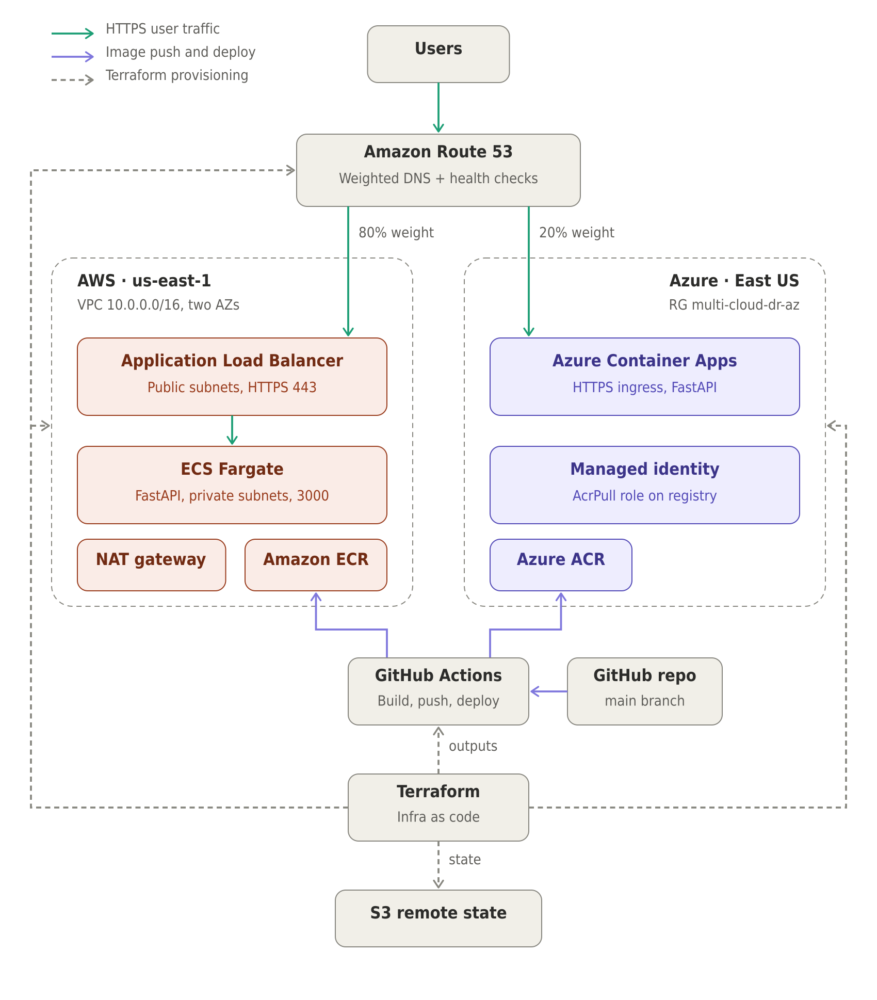
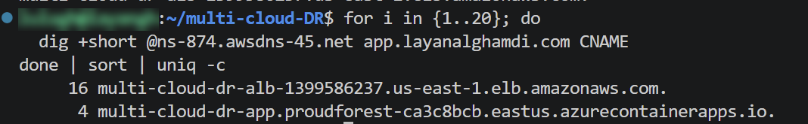
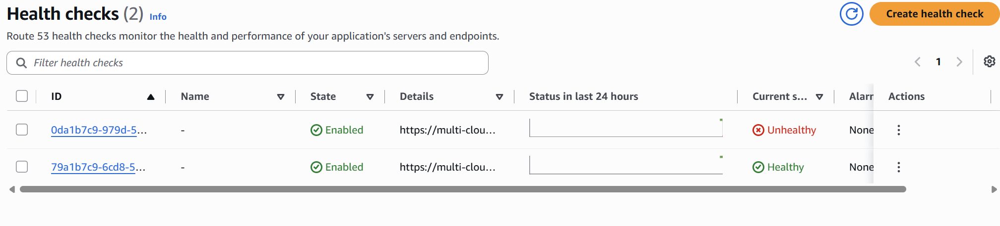
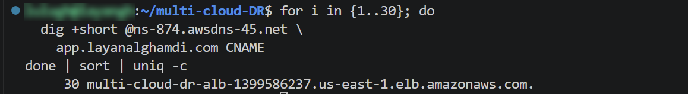
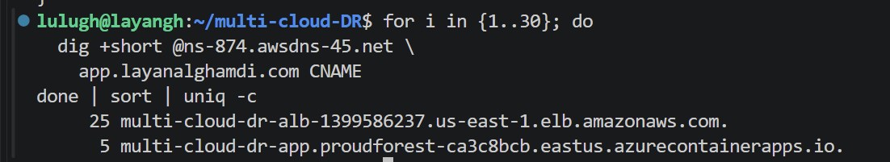

# Multi-Cloud High Availability & DNS Failover | AWS + Azure

A hands-on Cloud/DevOps project demonstrating the deployment of a containerized web application across **AWS and Microsoft Azure**, using Terraform for Infrastructure as Code, GitHub Actions for CI/CD, and Amazon Route 53 for health-based weighted DNS routing.

The architecture uses AWS as the primary environment and Azure as a secondary environment, with an **80/20 weighted DNS configuration** and automated DNS-level failover when an endpoint is marked unhealthy.

## Project Objectives

- Provision and manage infrastructure across two cloud providers using Terraform.
- Deploy a containerized Python application to AWS ECS Fargate and Azure Container Apps.
- Automate application deployment through GitHub Actions.
- Configure HTTPS and custom-domain access.
- Implement health-checked weighted DNS routing.
- Simulate a cloud endpoint failure and verify DNS failover and recovery.

## Architecture Overview



### AWS — Primary Environment

- Amazon VPC with public and private subnets across two Availability Zones
- Application Load Balancer (ALB)
- Amazon ECS with AWS Fargate
- Amazon Elastic Container Registry (ECR)
- AWS Certificate Manager (ACM)
- Amazon Route 53
- Amazon CloudWatch Logs

### Azure — Secondary Environment

- Azure Resource Group
- Azure Container Registry (ACR)
- Azure Container Apps
- Azure Container Apps Environment
- Azure Log Analytics Workspace
- Managed Identity and Azure RBAC
- Custom-domain TLS certificate

### Infrastructure & Deployment

- **Terraform:** Multi-cloud infrastructure provisioning and remote state management
- **Docker:** Application containerization
- **GitHub Actions:** Automated container image builds and deployment
- **AWS CLI / Azure CLI:** Cloud resource management and verification

## DNS Routing & High Availability

The application was previously accessible through:

`https://app.layanalghamdi.com`

Amazon Route 53 uses weighted CNAME records with HTTPS health checks against the `/health` endpoint.

Deployment Status: The cloud infrastructure has been intentionally decommissioned to avoid ongoing costs. The application is no longer publicly accessible, but the infrastructure code, CI/CD configuration, and documented test results remain available in this repository.

| Environment | DNS Weight | Application Platform |
|---|---|---|
| AWS | 80% | ECS Fargate behind ALB |
| Azure | 20% | Azure Container Apps |

When both endpoints are healthy, Route 53 returns DNS answers according to the configured weights.

When an endpoint is marked unhealthy, Route 53 can exclude it from DNS answers and direct new DNS resolutions to the remaining healthy endpoint.

**Note:** Weighted DNS does not guarantee an exact HTTP traffic split. DNS caching and client resolver behavior affect actual traffic distribution.

## CI/CD Pipeline

GitHub Actions automates deployment of the containerized application across AWS and Azure.

The workflow is defined in:

`.github/workflows/deploy.yml`

The deployment integrates Docker image builds, container registries, and cloud application services.

AWS uses Amazon ECR and ECS Fargate, while Azure uses Azure Container Registry and Container Apps.

## DNS Failover Simulation

A controlled failover experiment was conducted to verify Route 53's health-based routing behavior.

### Test 1 — Normal Operation

Both AWS and Azure health checks were healthy.

Route 53 returned DNS responses for both cloud environments.

**Observed results (20 queries):**

| Environment | DNS Responses |
|---|---|
| AWS | 16 |
| Azure | 4 |



### Test 2 — Simulated Azure Failure

The Azure Route 53 health check was temporarily inverted using the AWS CLI.

This caused Route 53 to mark Azure unhealthy without shutting down the Azure application.

During the simulation:

- Azure health check: Unhealthy
- AWS health check: Healthy
- Route 53 stopped returning Azure in the observed DNS queries.



### Test 3 — DNS Failover to AWS

After Azure was marked unhealthy, 30 DNS queries were sent directly to an authoritative Route 53 nameserver.

**Observed result:**

```text
30 multi-cloud-dr-alb-1399586237.us-east-1.elb.amazonaws.com.
```

All 30 queries returned the AWS Application Load Balancer.



### Test 4 — Azure Recovery

The Azure health check was restored to its normal configuration.

After recovery, Route 53 resumed returning both AWS and Azure endpoints.

**Observed results (30 queries):**

| Environment | DNS Responses | Observed Share |
|---|---|---|
| AWS | 25 | 83.3% |
| Azure | 5 | 16.7% |



Both health checks subsequently returned to Healthy status.


### Test Summary

| Scenario | Expected Behavior | Observed Result |
|---|---|---|
| Normal operation | Weighted AWS/Azure DNS routing | Passed |
| Azure marked unhealthy | Route 53 excludes Azure | Passed |
| DNS failover | AWS receives all sampled DNS answers | Passed |
| Azure restored | Weighted routing resumes | Passed |
| Terraform validation | Infrastructure matches configuration | No changes |

**Scope:** This experiment validates DNS-level failover and recovery through health-check inversion. It does not represent a complete application outage or stateful disaster recovery test.

## Application Health Verification

**AWS Application**


**Azure Application**


The Python application exposes a health endpoint and identifies the serving cloud environment.

Example AWS response:

```json
{
  "status": "healthy",
  "region": "us-east-1",
  "cloud": "aws",
  "version": "1.0"
}
```

This supports endpoint verification and helps identify which cloud environment serves a request.

## Deployment Prerequisites

- Terraform (verify the required version against the repository configuration)
- AWS CLI and valid AWS credentials
- Azure CLI authentication (`az login`)
- Docker
- GitHub Actions configuration and deployment credentials
- Existing Route 53 hosted zone
- Valid TLS certificates for the application domain
- Azure permissions to create required role assignments

Keep certificates, passwords, Terraform variable files containing secrets, and Terraform state outside source control.

The Azure PFX certificate content is stored in Terraform state, so remote state access must be restricted and encrypted.

The GitHub Actions workflow reads AWS and Azure resource names from Terraform
outputs. Apply the configuration after adding or changing these outputs so
they are present in remote state. Before running the workflow, set
`create_ecs_service = true` and `enable_azure_container_app = true`, then apply
Terraform. Configure the `AWS_ACCESS_KEY_ID`, `AWS_SECRET_ACCESS_KEY`,
`AZURE_CLIENT_ID`, `AZURE_TENANT_ID`, and `AZURE_SUBSCRIPTION_ID` repository
secrets. The Azure identity must have a federated credential for this GitHub
repository and permission to push to ACR and update the Container App.

## Deployment Procedure

The Azure environment was deployed in stages to avoid switching DNS traffic before the secondary application and certificate were ready.

1. **Provision Azure foundation:** Set `azure_dns_mode = "aws_only"` and `enable_azure_container_app = false`. Apply Terraform to create the registry, managed identity, and supporting infrastructure.

2. **Build and push the container image to Azure Container Registry:**

   ```bash
   IMAGE_URI="$(terraform output -raw azure_image_uri)"
   az acr login --name "$(terraform output -raw azure_acr_name)"
   docker build --platform linux/amd64 -f app/dockerfile -t "$IMAGE_URI" app
   docker push "$IMAGE_URI"
   ```

3. **Deploy Azure Container Apps:** Set `enable_azure_container_app = true` and apply Terraform.

4. **Validate the custom domain:** Set `azure_dns_mode = "azure_validation"` and apply. This creates the Azure domain verification record and temporarily switches the hostname for validation. DNS propagation and temporary HTTPS interruption may occur.

5. **Configure HTTPS:** Set `enable_azure_certificate = true` and
   `enable_azure_custom_domain = true`, provide `azure_certificate_pfx_path`,
   and securely set `TF_VAR_azure_certificate_password`. Apply Terraform and
   validate the custom domain and `/health` endpoint.

6. **Enable weighted routing:** After both endpoints and certificates are validated, set `azure_dns_mode = "weighted"` and apply Terraform. This configures health-checked weighted CNAME records with 80% AWS and 20% Azure weights.

Review the Terraform plan before each deployment stage.

## Security Considerations

- Application workloads run in managed container environments.
- AWS uses private subnets for ECS application tasks.
- HTTPS is enabled for the public application endpoint.
- Azure Container Registry access uses managed identity and RBAC.
- Terraform state is stored remotely with encryption and access controls.
- Sensitive credentials and certificates are excluded from Git.
- Health checks monitor application endpoint availability.

## Limitations & Future Improvements

- Perform an actual application-level outage simulation and measure recovery time.
- Measure recovery time objective (RTO) under controlled conditions.
- Add monitoring, alerting, and automated operational reporting.
- Implement automated TLS certificate renewal for Azure.
- Migrate AWS GitHub Actions credentials to OIDC-based authentication.
- Add persistent data replication and test recovery point objective (RPO) for stateful workloads.
- Evaluate DNS caching behavior and client-side failover limitations.

## Project Status

**Completed:** Multi-cloud infrastructure deployment, CI/CD integration, HTTPS configuration, weighted DNS routing, and controlled DNS failover/recovery testing.

The infrastructure was intentionally decommissioned to avoid ongoing cloud charges. The Terraform code, documentation, and test evidence remain available in this repository.